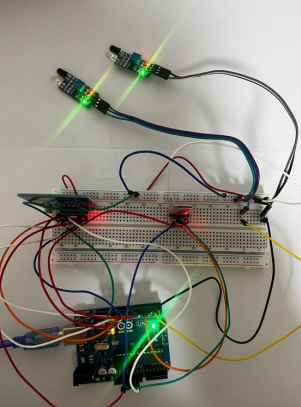
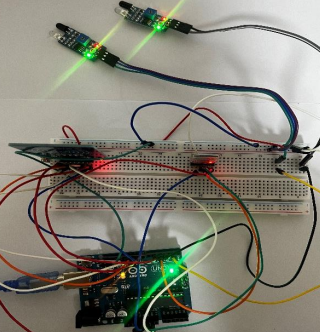
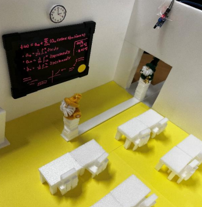
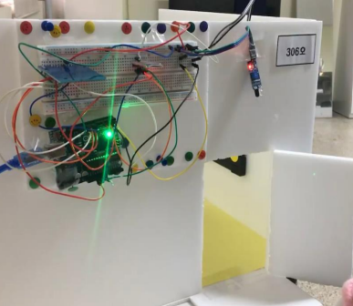

# 🏫 WTEC (Where is The Empty Classroom)

> **아두이노 기반 원격 강의실 수업 여부 및 실시간 재실 인원 확인 시스템**  
> *Arduino Uno, Bluetooth(BLE), MFRC522 RFID, IR Dual Sensor Array*

---

## 📌 목차
1. [프로젝트 배경 및 목적](#-프로젝트-배경-및-목적)
2. [주요 기능](#-주요-기능)
3. [하드웨어 구성 및 회로 연결 (Wiring Diagram)](#-하드웨어-구성-및-회로-연결-wiring-diagram)
4. [시스템 동작 시나리오 및 소프트웨어 구조](#-시스템-동작-시나리오-및-소프트웨어-구조)
5. [프로토타입 제작 결과](#-프로토타입-제작-결과)
6. [트러블슈팅 및 성능 개선 (Troubleshooting)](#-트러블슈팅-및-성능-개선-troubleshooting)
7. [팀원 및 역할](#-팀원-및-역할)

---

## 📖 프로젝트 배경 및 목적

대학 생활 중 공강 시간에 스터디, 과제, 조별 모임, 휴식 등을 위해 빈 강의실을 찾으려면 건물 내 여러 층을 직접 걸어 다니며 일일이 확인해야 하는 불편함이 있었습니다.

**WTEC(Where is The Empty Classroom)**는 이러한 비효율적인 동선과 시간 낭비를 해결하기 위해 개발되었습니다. 모바일 기기(스마트폰)에서 블루투스를 통해 원하는 강의실 호수를 입력하면, 직접 방문하지 않고도 **해당 강의실의 수업 진행 여부, 현재 재실 인원수, 잔여 좌석 수**를 실시간으로 확인할 수 있는 스마트 캠퍼스 IoT 솔루션입니다.

---

## ✨ 주요 기능

1. **RFID 기반 실시간 수업 상태 제어**
   * 교수자 또는 관리자가 고유 RFID 카드를 태깅하여 수업 시작/종료 상태를 토글
   * 카드 태그 시 4-byte UID를 비교하여 이전 상태와 동일한 카드가 인식되었는지 판별 (`Class = 1: 수업 중 / Class = 0: 수업 없음`)

2. **적외선(IR) 듀얼 센서를 통한 인원 입·퇴실 감지 및 좌석 수 계산**
   * 출입문에 2개의 적외선 센서(외측 Sensor 1, 내측 Sensor 2)를 순차 배치
   * 진입 순서($\text{Sensor 1} \rightarrow \text{Sensor 2}$)에 따라 입실 카운트 증가 (`count++`)
   * 강의실 정원(기준 50석) 대비 잔여 좌석 자동 연산 (`chair = 50 - count`)

3. **블루투스(SoftwareSerial) 무선 인터랙션**
   * 스마트폰 터미널 앱을 통해 대화형 인터페이스 제공
   * `1`: 탐색 모드 진입 $\rightarrow$ 강의실 호수 입력(예: `306`, `682`) $\rightarrow$ 수업 여부, 재실 인원, 남은 좌석 정보 출력
   * `2`: 세션 종료 메시지 출력

---

## 🔌 하드웨어 구성 및 회로 연결 (Wiring Diagram)

하나의 아두이노 우노(Arduino Uno) 보드에 브레드보드를 매개로 세 가지 핵심 모듈을 병렬 연결하여 구성했습니다.


*(사진 설명: 브레드보드를 통해 아두이노 우노에 RFID, 블루투스, 적외선 센서를 결선한 전체 회로)*

### 핀 매핑 테이블 (Pin Mapping)

| 모듈명 | 모듈 핀 | 아두이노 우노 핀 | 비고 / 통신 방식 |
| :--- | :--- | :--- | :--- |
| **MFRC522 (RFID)** | SDA (SS) | **D10** | SPI 통신 |
| | SCK | **D13** | SPI 통신 |
| | MOSI | **D11** | SPI 통신 |
| | MISO | **D12** | SPI 통신 |
| | RST | **D9** | Reset 제어 |
| | VCC / GND | **3.3V** / GND | **주의: 3.3V 필수** |
| **블루투스 모듈 (iOS 호환)** | TXD | **D4 (RXD)** | SoftwareSerial 교차 연결 |
| | RXD | **D5 (TXD)** | SoftwareSerial 교차 연결 |
| | VCC / GND | **5V** / GND | 통신 속도: 9600 bps |
| **적외선 센서 1 (강의실 외측)** | OUT | **D2** | digitalRead() 감지 |
| | VCC / GND | **5V** / GND | 물체 접근 시 LOW 출력 |
| **적외선 센서 2 (강의실 내측)** | OUT | **D3** | digitalRead() 감지 |
| | VCC / GND | **5V** / GND | 물체 접근 시 LOW 출력 |


*(사진 설명: USB 전원 인가 후 각 모듈 정상 구동 상태 확인)*

---

## 💻 시스템 동작 시나리오 및 소프트웨어 구조

```text
[사용자 모바일 앱]
       │ (1. 탐색 요청 / 강의실 호수 전송)
       ▼
 [블루투스 (HC-06/BLE)]
       │
       ▼
 [아두이노 우노 (Main Controller)]
       ├── [RFID (RC522)] ───► 수업 진행 여부(Class: 0 or 1) 확인
       └── [적외선 센서 1, 2] ─► 입/퇴실 판별 및 현재 인원(count) 산출
       │
       ▼ (수업 여부, 재실 인원, 잔여 좌석 데이터 패킷 전송)
[사용자 모바일 화면 출력]
```

### 핵심 제어 로직
1. **UID 비교 알고리즘**:
   ```cpp
   bool isEqualCardUID(byte cardUID1[], byte cardUID2[]) {
     for (byte i = 0; i < 4; i++) {
       if (cardUID1[i] != cardUID2[i]) return false;
     }
     return true;
   }
   ```
2. **모바일 인터랙션 예시 (시리얼 출력)**:
   ```text
   Let's start WTEC
   탐색을 원하면: 1 입력
   종료를 원하면: 2 입력
   >> 1
   강의실 입력:
   >> 306
   현재 수업 없음
   현재 강의실에 3명 있음
   남은 좌석 47석
   ```

---

## 🛠 프로토타입 제작 결과

강의실 환경을 사실적으로 재현하기 위해 폼보드(우드락)와 미니어처 책상, 의자, 칠판, 출입문 모형을 직접 설계 및 조립하여 테스트베드를 제작했습니다.

| 모의 강의실 내부 | 모의 강의실 외부 (시스템 부착) |
| :---: | :---: |
|  |  |
| 책상/의자 배치 및 출입 통로 적외선 센서 라인 구축 | 강의실 문 외벽에 아두이노, 브레드보드, RFID 태그 영역 배치 |

---

## 🔍 트러블슈팅 및 성능 개선 (Troubleshooting)

프로젝트 구현 과정에서 직면한 4가지 핵심 문제와 해결 과정입니다.

### 1. 광각형 적외선 센서의 난반사 감지 오류 $\rightarrow$ **직선 지향형 센서로 교체**
* **문제 현상**: 초기 적외선 센서 앞을 어떤 거리로 지나가도 계속 감지 상태(`LOW`/`1`)로 유지되어 출입을 정확히 카운팅하지 못함.
* **원인 분석**: 센서 전면의 반구형 증폭 렌즈로 인해 감지 범위가 입체적인 사방으로 확장되어 주변 벽면과 물체에 간섭 발생.
* **해결**: 반구형 렌즈 제거 및 가변저항 조정으로도 좁은 출입문 폭 한정이 불가능하여, 빔이 직선 형태로 방출되는 **직선 지향형 적외선 센서로 재구매 및 교체**하여 해결.

### 2. 센서 모듈 병합 시 발생한 불규칙 딜레이 중첩 현상 $\rightarrow$ **조건부 비동기 구조 개선**
* **문제 현상**: 개별 모듈 코드를 합친 후 RFID는 작동하지만 적외선 센서가 동작을 건너뛰거나 지연 감지됨.
* **원인 분석**: `loop()` 함수 끝단에 RFID 다중 인식 방지를 위해 삽입했던 긴 `delay()`가 전체 프로세스를 일시 중지(Block)시켜, 그동안 진입한 적외선 센서 신호를 놓침.
* **해결**: 전체 루프에 걸려있던 `delay`를 제거하고, 태그 성공 시점 내부 `if` 블록 안으로만 지연 코드를 제한 배치하여 다른 센서 폴링 주기 정상화.

### 3. 동절기 저온 환경에서의 센서 오작동 고찰
* **문제 현상**: 난방이 되지 않는 복도나 추운 교실 환경에서 적외선 센서 오작동률 증가.
* **원인 및 고찰**: 저온 환경에 따른 적외선 발광 다이오드 및 수광 소자의 전기적 특성/저항값 변화. 향후 산업용 스펙의 온도 보상 회로 내장 센서 도입 또는 외곽 단열 케이싱 설계 필요성 도출.

### 4. 고정 딜레이 방식의 통과 속도 종속 문제 $\rightarrow$ **`millis()` 기반 타임스탬프 알고리즘 설계**
* **문제 현상**: `delay(800)` 방식을 사용해 사람이 센서 1을 지나 센서 2를 통과하는 시간이 정확히 0.8초 부근이어야만 카운팅되는 유연성 부족 문제 발생.
* **개선 알고리즘**:
  고정 지연 방식 대신 아두이노 타이머 함수인 `millis()`를 활용해 각 센서가 트리거된 시점의 타임스탬프(`time1`, `time2`)를 기록하고, 두 센서 감지 시간 차이가 허용 구간($|time1 - time2| < 1500\text{ ms}$) 이내인 경우 유효 통과로 판별하도록 알고리즘 개선.

---

## 👥 팀원 및 역할

* **양아연** : 하드웨어 회로 설계, 블루투스 모듈 연동 및 통신 코드 구현, 결과 보고서 작성
* **임도연** : 적외선 센서 회로 결선, 입/퇴실 카운팅 알고리즘 개발, 타임스탬프 로직 고안
* **조아영** : RFID 리더기(MFRC522) 통신 및 수업 판별 로직 구현, 모의 강의실 축소 모형 제작 및 부품 조달

---

## 📂 저장소 구조 (Repository Structure)

```text
├── docs/
│   └── images/
│       ├── circuit_overview.png     # 브레드보드 전체 결선 사진
│       ├── circuit_power_on.png     # 전원 인가 동작 사진
│       ├── prototype_interior.png   # 모의 강의실 내부 사진
│       └── prototype_exterior.png   # 모의 강의실 외벽 및 장치 장착 사진
├── sketch_WTEC/
│   └── sketch_WTEC.ino             # 아두이노 통합 메인 스케치 코드
└── README.md
```